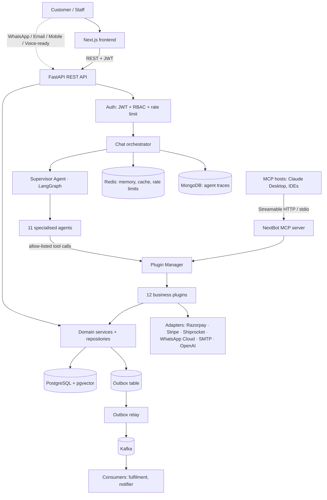
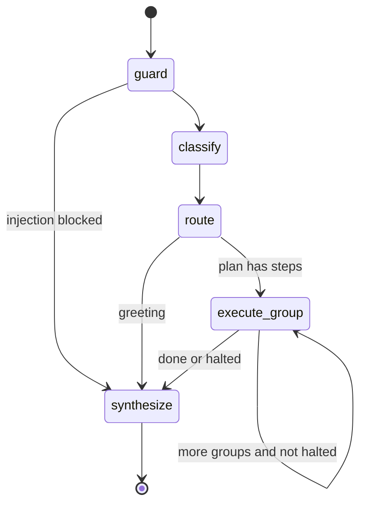

# NextBot AI — Autonomous Omnichannel E-Commerce Agent Platform

NextBot AI is a Python/FastAPI + Next.js e-commerce platform in which customers shop by talking to an AI assistant.
Instead of a single chatbot, a **Supervisor Agent** (a LangGraph state machine) routes each request to **11 specialised
agents**, and agents can act on the world **only** through **12 permission-checked business plugins** managed by a central
**Plugin Manager**. Policy questions are answered with **RAG** over a pgvector knowledge base, the same commerce tools are
exposed over the **Model Context Protocol**, and order/payment/shipment events flow through a **transactional outbox → Kafka**
pipeline. Everything runs in **demo mode** with no paid API keys.

> Fictional store, fictional data. Mock AI, mock payment gateway and mock courier are clearly labelled in the UI and API
> (`demo_mode`, `ai_provider`, `is_simulated`, notification status `SIMULATED`). Nothing pretends to be a live provider.

---

## Contents
1. [Problem statement & objectives](#1-problem-statement--objectives) · 2. [Features](#2-features) · 3. [Tech stack](#3-technology-stack) ·
4. [Architecture](#4-system-architecture) · 5. [Agents](#5-ai-agent-architecture) · 6. [Plugins](#6-plugin-architecture) ·
7. [Database](#7-database-architecture) · 8. [API](#8-api) · 9. [Quick start](#9-quick-start) · 10. [Configuration](#10-configuration) ·
11. [Testing](#11-testing--verified-results) · 12. [Deployment](#12-deployment) · 13. [Troubleshooting](#13-troubleshooting) ·
14. [Project layout](#14-project-layout)

Deep dives live in [`docs/`](docs): architecture, database design, agent workflows, plugin architecture, RAG, MCP, security,
deployment, testing and an **interview guide** (95 Q&As grounded in this code).

## 1. Problem statement & objectives
Online retail support and shopping flows are fragmented: search, stock, delivery, payments, returns and support live in
different systems, and a single LLM chatbot bolted on top either can't act or acts without guard-rails.

NextBot's goals:
* Let a customer go from *"black running shoes under ₹3,000 in size 9 — check stock and delivery"* to a paid, tracked order in chat.
* Every action goes through real services and database rows — no hard-coded answers.
* Make AI actions **safe by construction**: typed tool inputs, role permissions, agent allow-lists, iteration/time limits,
  prompt-injection defences, and human approval for sensitive operations.
* Be extensible: new capabilities are plugins; new channels are adapters.

## 2. Features
| Area | What's implemented |
|---|---|
| Commerce | Catalogue (brands, categories, variants, sizes, colours, specs, images, reviews), search & filters, cart with coupons/GST/shipping, address book (add/edit/delete/default, inline at checkout), checkout with oversell-proof reservation, mock payments with idempotency + signed webhooks, order state machine, shipments & tracking, returns with eligibility window, refunds |
| AI | Supervisor + 11 agents, LangGraph orchestration with sequential/safe-parallel groups, mock + OpenAI providers (function calling), conversation memory (Redis), traces (MongoDB) |
| Plugins | 12 plugins, Plugin Manager (registration, lifecycle, enable/disable, config, health, circuit breaker), DB-backed registry, execution log, admin dashboard |
| RAG | Markdown KB → chunking → embeddings → pgvector (HNSW) → retrieval with metadata filters → grounded answer with citations, fallback when unsure |
| MCP | Official `mcp` SDK v2 server with 11 tools over Streamable HTTP (`/mcp/`, bearer JWT) and stdio; MCP client plugin with tool allow-lists |
| Events | Transactional outbox, Kafka producer (idempotent) & consumers, retries with backoff, dead-letter topics, idempotent processing |
| Security | JWT access/refresh, bcrypt (pwdlib), RBAC + permission strings, per-user rate limiting, audit log, HMAC webhooks, secrets env-only, ownership checks, prompt guard |
| Human-in-the-loop | Approval requests for high-value refunds, large cancellations, big stock adjustments, risky orders |
| Ops | Docker (full + lightweight), GitHub Actions, Kubernetes manifests, Prometheus metrics, Grafana dashboard, optional OpenTelemetry |
| Frontend | 22 Next.js pages: landing (with top-rated products), auth, customer dashboard, AI assistant, catalogue, product, cart, checkout, orders, tracking, returns, addresses, admin overview, all orders (courier simulation), analytics, inventory, agents, plugins, plugin config, approvals, support desk |

## 3. Technology stack
Backend: **Python 3.12+, FastAPI, Uvicorn, Pydantic v2, SQLAlchemy 2 (async), Alembic, PostgreSQL + pgvector, Redis,
MongoDB (PyMongo async), aiokafka, PyJWT, pwdlib[bcrypt], HTTPX, prometheus-client, OpenTelemetry**.
AI: **LangGraph** (Supervisor graph), **OpenAI** (optional; function calling + embeddings), official **MCP** SDK.
LangChain is deliberately *not* used — LangGraph + a small typed tool layer covers orchestration without two overlapping frameworks.
Search: PostgreSQL by default; optional **OpenSearch** read model (`SEARCH_BACKEND=opensearch`).
Frontend: **Next.js 15 (App Router), React 19, TypeScript, Tailwind CSS**, Fetch API, React context/hooks.
Tests: **pytest + AnyIO plugin, FastAPI TestClient, unittest-style fakes, Testcontainers (PostgreSQL), Playwright**.
Versions are pinned as compatible ranges in `backend/requirements.txt` and `frontend/package.json`.

## 4. System architecture

A **modular monolith**: modules have clean seams (plugins depend on service *contracts*, events go through the outbox) so
payments, notifications or search can be split into services later without rewriting callers. Details: [`docs/architecture.md`](docs/architecture.md).

## 5. AI agent architecture
| # | Agent | Uses plugins | Typical intents |
|---|---|---|---|
| 1 | **Supervisor** | none (delegates only) | classify → plan → execute groups → compose |
| 2 | Shopping | product_search, recommendation.related, order_management.cart_* | product_search, add/view/remove cart |
| 3 | Product Intelligence | product_search (details, semantic), recommendation.* | recommend, details, compare |
| 4 | Inventory | inventory.* | stock for results, low_stock |
| 5 | Order Management | order_management (checkout/get/latest/history/cancel) | checkout, track, history, cancel |
| 6 | Payment | payment.*, fraud_detection.assess_payment | pay, payment_issue |
| 7 | Return & Refund | order_management.return_* | return_request, return_status |
| 8 | Customer Support | customer_support.*, email.send, whatsapp.send_template | faq (RAG), escalate |
| 9 | Logistics | shipping.* | delivery_estimate, create_shipment, track |
| 10 | Fraud Detection | fraud_detection.* | assess_checkout |
| 11 | Analytics | analytics.* | sales, plugin status, agent executions |
| 12 | Notification | email.send, whatsapp.send_template | lifecycle notifications (also driven by events) |


Each agent has typed `AgentTask`/`AgentResult`, a tool allow-list, `max_iterations`, a timeout and execution tracing.
See [`docs/agent-workflows.md`](docs/agent-workflows.md) for every plan, including checkout:
`fraud_detection → order_management → payment → logistics → notification`.

## 6. Plugin architecture
`BasePlugin` (ABC) defines `get_plugin_id/get_name/get_version/get_description/initialize/execute/validate_configuration/health_check/shutdown`;
actions are declared with `@action(name, PydanticInput, "resource:verb")`. `PluginManager.execute()` does, in order:
lookup → status check → action lookup → **input validation** → **user permission** → **agent allow-list** → execution with
timeout → stats + execution record → structured `PluginResult`; it never raises to the caller. Five consecutive unexpected
errors open a **circuit breaker** (status `FAILED`). Secrets are env-only and always masked.

| # | Plugin | Local implementation | External adapter |
|---|---|---|---|
| 1 | Product Search | ✅ SQL filters + semantic search | OpenSearch (optional) |
| 2 | Recommendation | ✅ co-purchase + content-based + budget | — |
| 3 | Inventory | ✅ atomic reservations, low-stock | — |
| 4 | Payment | ✅ mock gateway, idempotency, refunds | Razorpay, Stripe (need keys) |
| 5 | Order Management | ✅ cart, checkout, orders, returns | — |
| 6 | Shipping | ✅ mock courier, tracking, ETA | Shiprocket (needs keys) |
| 7 | Customer Support | ✅ RAG answers, FAQs, escalation | OpenAI for generation (optional) |
| 8 | WhatsApp | ✅ mock adapter, webhook parser | WhatsApp Cloud API (needs token) |
| 9 | Email | ✅ templates, mock adapter | SMTP (needs host) |
| 10 | Analytics | ✅ sales, products, inventory, agent/plugin metrics | — |
| 11 | Fraud Detection | ✅ explainable rule-based scoring | — |
| 12 | MCP Integration | ✅ real MCP client (in-process/HTTP/stdio) | any MCP server |

More: [`docs/plugin-architecture.md`](docs/plugin-architecture.md).

## 7. Database architecture
PostgreSQL holds 33 domain entities (User, Role, Permission, CustomerProfile, Address, Product, ProductCategory, ProductVariant,
Brand, ProductImage, Inventory, Warehouse, ShoppingCart, CartItem, Order, OrderItem, Payment, Refund, Shipment, ReturnRequest,
Conversation, ConversationMessage, AgentExecution, AgentToolExecution, Plugin, PluginExecution, PluginConfiguration,
Notification, Review, Coupon, KnowledgeDocument, ApprovalRequest, AuditLog) plus three supporting tables (KnowledgeChunk with a
`vector(384)` column, OutboxEvent, ProcessedEvent). MongoDB stores schemaless per-turn agent traces; Redis stores conversation
working memory, search-result caches and rate-limit counters. ER diagram and constraints: [`docs/database-design.md`](docs/database-design.md).

## 8. API
Interactive docs at **http://localhost:8000/docs** (OpenAPI 3). Main groups (all under `/api/v1`):
`auth` (register, login, refresh, me, addresses CRUD + set default) · `products` (list, search, detail, CRUD — paging with `page`/`size`, filters `q`, `category`, `brand`, `min_price`, `max_price`, `variant_size`, `colour`, `in_stock`, `sort`) · `cart` · `orders` (checkout,
list, detail, cancel, tracking) · `payments` (initiate, get, webhook) · `inventory` · `returns` · `shipments` · `ai` (chat,
agent/execute, conversations) · `plugins` (list, detail, enable, disable, config, executions) · `analytics` · `admin`
(users, orders, agents, plugins, approvals + decision, notifications, audit, traces). Also `/health`, `/health/ready`,
`/metrics`, and the MCP endpoint `/mcp/`.

## 9. Quick start
**Option A — everything (PostgreSQL+pgvector, Redis, MongoDB, Kafka, Prometheus, Grafana):**
```bash
docker compose up --build
# frontend http://localhost:3000 · API docs http://localhost:8000/docs · Grafana http://localhost:3001
```
**Option B — lightweight (SQLite, in-memory bus/cache):** `docker compose -f docker-compose.dev.yml up --build`

**Option C — no Docker:**
```bash
cd backend && python3 -m venv .venv && . .venv/bin/activate && pip install -r requirements-dev.txt
cp ../.env.example .env        # demo defaults: SQLite, mock AI, mock payments
uvicorn app.main:create_app --factory --reload
cd ../frontend && npm install && npm run dev
```
Demo logins (fictional): `asha@nextbot.demo / Demo@1234` (customer), `rahul@…`, `meera@…` (customers),
`admin@nextbot.demo / Admin@1234`, `support@nextbot.demo / Support@1234`, `inventory@nextbot.demo / Inventory@1234`.

**The 12 demos** (type them in the AI Assistant): laptop under ₹60,000 · black running shoes size 9 · recommend a smartphone
on my budget · add the first product to my cart · place my order · track my latest order · what is your return policy ·
show products with low inventory *(inventory manager/admin)* · I want to return my order · this month's sales *(admin)* ·
status of all plugins *(admin)* · recent AI agent executions *(admin)*.

## 10. Configuration
All settings are environment variables (see [`.env.example`](.env.example)). Key ones:
`DEMO_MODE`, `AI_PROVIDER=mock|openai` (+`OPENAI_API_KEY`), `PAYMENT_PROVIDER=mock|razorpay|stripe`, `EVENT_BUS=memory|kafka`,
`DATABASE_URL`, `REDIS_URL`, `MONGO_URL`, `SEARCH_BACKEND`, `JWT_SECRET` (≥32 chars), `WEBHOOK_SECRET`,
RAG tuning (`RAG_CHUNK_SIZE`, `RAG_CHUNK_OVERLAP`, `RAG_TOP_K`, `RAG_MIN_SCORE`), and policy thresholds
(`REFUND_APPROVAL_THRESHOLD`, `CANCELLATION_APPROVAL_THRESHOLD`, `INVENTORY_ADJUSTMENT_APPROVAL_UNITS`, `FRAUD_REVIEW_SCORE`,
`RETURN_WINDOW_DAYS`). **MCP:** connect any MCP host to `http://localhost:8000/mcp/` with `Authorization: Bearer <access token>`,
or run `NEXTBOT_MCP_USER=asha@nextbot.demo python -m app.mcp.stdio_main` for stdio ([`docs/mcp-integration.md`](docs/mcp-integration.md)).

## 11. Testing — verified results
**Latest run on Windows (dev stack):** ruff ✅ · mypy ✅ · **89 unit + 21 integration tests ✅** (incl. Testcontainers PostgreSQL
concurrency) · Alembic ✅ · frontend type-check, lint, production build ✅ · **5/5 Playwright E2E ✅**.
**Full infrastructure verified:** PostgreSQL+pgvector, Redis, MongoDB, Kafka, Prometheus (target UP), Grafana dashboard with
live data, and MCP over Streamable HTTP (11 tools listed, structured tool call) — Details: [`docs/testing.md`](docs/testing.md).

Run: `cd backend && pytest -q` (unit + integration) · `npx playwright test` (frontend E2E, needs the stack running).
**On Windows, one command runs everything and saves real results to `docs/test-results-local.md`:**
`powershell -ExecutionPolicy Bypass -File .\scripts\verify.ps1`

**Executed in the build environment (Python 3.13, `mcp` 2.3.0 installed; no network for installs):**
`89 passed` — 15 agent-orchestration tests (all 12 demos through the real Supervisor → agents → Plugin Manager → 12 plugins),
13 domain-rule tests, 5 event-bus tests (retry, DLQ, idempotency), 19 intent tests, 4 MCP protocol tests over the SDK's
in-memory transport + 1 over **real Streamable HTTP with bearer auth (uvicorn)**, 9 Plugin Manager tests, 9 RAG tests, 14 security tests.
`mypy app` (with the pydantic plugin): *no issues in 139 files* (FastAPI/SQLAlchemy were not installed there, so they were type-checked as `Any`).

**Written but NOT executed there** (FastAPI, SQLAlchemy, aiosqlite, Next.js, Docker were unavailable): 18 API integration
tests (auth, catalogue, cart, checkout, payment success/failure/idempotency, order privacy, webhooks, returns, all 12 chat demos,
plugin admin, approvals, metrics), 1 Testcontainers PostgreSQL concurrency test, 3 Playwright specs, the frontend type-check
and build. They run in CI (`.github/workflows/ci.yml`). Full breakdown: [`docs/testing.md`](docs/testing.md).

## 12. Deployment
Docker images (non-root, health-checked), GitHub Actions (lint, types, tests, build, E2E, push to GHCR), Kubernetes manifests
(Deployments, Services, HPA, ConfigMap, Secret template, ALB Ingress, migration Job) and an AWS guide (EKS + RDS PostgreSQL
with pgvector + ElastiCache + MSK + DocumentDB/Atlas): [`docs/deployment.md`](docs/deployment.md).

## 13. Troubleshooting
| Symptom | Fix |
|---|---|
| `JWT_SECRET` validation error at start | Use ≥ 32 characters |
| `asyncpg`/`vector` errors on Postgres | Use the `pgvector/pgvector` image or `CREATE EXTENSION vector` |
| Assistant says it couldn't search | The Product Search plugin is disabled — enable it under Admin → Plugins |
| Chat replies sound templated | That's the mock AI provider; set `AI_PROVIDER=openai` and `OPENAI_API_KEY` |
| Payment plugin shows `FAILED` | A live provider was selected without keys; check `last_error` on the plugin page |
| CORS errors in the browser | Add the frontend origin to `CORS_ORIGINS` |
| MCP `421`/host rejected | Add the public host to `MCP_ALLOWED_HOSTS` |
| Kafka consumers idle | `EVENT_BUS=kafka` and topics created by `kafka-init` (`infrastructure/kafka/create-topics.sh`) |

## 14. Project layout
```
backend/app/  api · core · domain · models · schemas · repositories · services · agents · orchestration · plugins · rag · mcp ·
              integrations · events · security · monitoring · database · bootstrap.py · main.py
backend/      migrations/ · tests/{unit,integration} · requirements*.txt · pyproject.toml · Dockerfile
frontend/     app/ (20 pages) · components/ · hooks/ · services/ · types/ · public/ · e2e/
infrastructure/ docker · kafka · monitoring (Prometheus, Grafana) · kubernetes
docs/ · scripts/ · docker-compose.yml · docker-compose.dev.yml · .env.example
```
