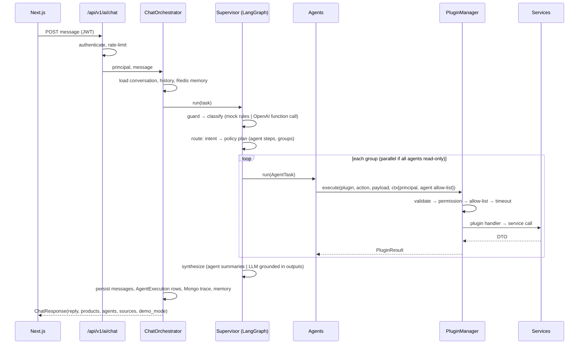

# Architecture

## Style: modular monolith with service-ready seams
One FastAPI process (horizontally scalable, stateless apart from in-process metrics) organised as modules with one-way
dependencies:

```
api  →  services  →  repositories  →  models (SQLAlchemy)
 │         ▲
 │         └── plugins (depend only on services/contracts.py Protocols)
 │                ▲
 └── orchestration → agents → PluginManager
domain/  (pure business rules: pricing, order state machine, returns, delivery ETA, fraud scoring, approval policy)
```

* **Agents never import services or SQLAlchemy.** They call `run.call(plugin_id, action, payload)`.
* **Plugins never import SQLAlchemy.** They call methods on `ServiceContainer` Protocols (`app/services/contracts.py`).
  That is why the full Supervisor → agents → plugins path is unit-tested against in-memory fakes (`tests/fakes.py`).
* **Services own transactions.** One request = one `AsyncSession` (unit of work, committed by the `get_session` dependency).
  Multi-step writes (checkout, payment, returns, cancellations, approvals) use `session.begin_nested()` savepoints so a
  failure inside a chat turn leaves no partial rows.
* **Events leave through the outbox.** Services write `OutboxEvent` rows in the same transaction; the relay publishes later.

## Request lifecycle (chat)


## Omnichannel
* **Web chat** — fully implemented (`/assistant`).
* **Mobile** — the same REST API (JWT, JSON, pagination) is mobile-ready.
* **WhatsApp** — `WhatsAppPlugin` sends via the Cloud API adapter (mock by default) and parses inbound webhooks
  (`handle_webhook`). `ChatRequest.channel` records the channel on the conversation.
* **Email** — `EmailPlugin` (SMTP or mock), templated lifecycle emails.
* **Voice** — extension point: a voice gateway transcribes speech and posts to `/api/v1/ai/chat` with `channel="VOICE"`.

## Infrastructure roles
| Component | Role | Fallback in demo mode |
|---|---|---|
| PostgreSQL + pgvector | system of record + vector search | SQLite (vectors stored as JSON, cosine in Python) |
| Redis | conversation memory, search-ID cache, rate limits | in-process `MemoryCache` |
| MongoDB | per-turn agent traces (plan, entities, outputs) | in-process ring buffer |
| Kafka | domain events between modules | `InMemoryEventBus` (same retry/DLQ/idempotency code) |
| OpenSearch | optional fuzzy product search read model | SQL `LIKE` + filters |

## Why these boundaries
* Plugins as the only action surface gives a single place for validation, authorisation, metering and kill-switches.
* Contracts as Protocols make the agent layer testable and let a plugin swap a local service for a remote one later.
* The outbox makes "order created" and "OrderCreated published" atomic without distributed transactions.
