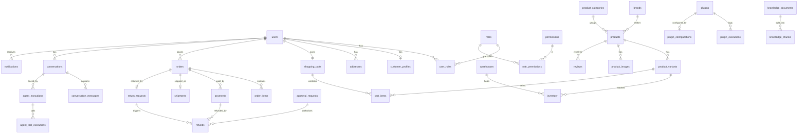

# Database design

PostgreSQL 16 + pgvector. Models: `backend/app/models/*.py`. Migration: `migrations/versions/0001_initial_schema.py`
(creates the model metadata, the `vector` extension and an HNSW cosine index on `knowledge_chunks.embedding`).
Every table has an integer or natural primary key; most have `created_at`/`updated_at` (UTC, timezone-aware).
Constraint names follow a naming convention (`pk_`, `fk_`, `uq_`, `ck_`, `ix_`) so Alembic diffs are stable.



## Key tables and rules
| Table | Notes |
|---|---|
| `users` | unique email (indexed), bcrypt hash, `is_active`; roles via `user_roles` |
| `roles`, `permissions` | seeded from `ROLE_PERMISSIONS`; permission strings `resource:verb`, `*` for ADMIN/SYSTEM |
| `customer_profiles` | 1:1 with user; `budget_hints` JSON used by recommendations; WhatsApp opt-in; loyalty |
| `addresses` | unique `(user_id, label)`; 6-digit PIN validated at the API |
| `products` | CHECK `price > 0`, CHECK `mrp >= price`; index `(category_id, price)`; soft delete via `is_active` |
| `product_variants` | unique `sku`; size/colour indexed; optional `price_override` |
| `inventory` | unique `(variant_id, warehouse_id)`; CHECK `quantity >= 0`, `reserved >= 0`, `reserved <= quantity` |
| `shopping_carts` / `cart_items` | one cart per user; unique `(cart_id, variant_id)`; CHECK `quantity > 0` |
| `orders` | unique `order_number`; status indexed; `(user_id, created_at)` index; immutable `shipping_address` snapshot; `reservation_expires_at`; `payment_failures` |
| `order_items` | price/name/SKU snapshot, `warehouse_id` of the reservation, `category_slug` for analytics/returns |
| `payments` | unique `idempotency_key`, unique `provider_reference`; **no card data** |
| `refunds` | linked to payment, optional return and approval |
| `shipments` | one per order; unique tracking number; `events` JSON timeline |
| `return_requests` | one per order (unique `order_id`) |
| `knowledge_documents` / `knowledge_chunks` | chunk `embedding vector(384)` (HNSW, cosine), `category` indexed for metadata filters |
| `agent_executions` / `agent_tool_executions` | every agent run and each tool call it made |
| `plugins` / `plugin_executions` / `plugin_configurations` | durable registry, execution log, non-secret overrides |
| `approval_requests` | action, status, payload, reviewer, result |
| `audit_logs` | who did what; details redacted for secrets |
| `outbox_events` | `published_at IS NULL` = pending (indexed) |
| `processed_events` | unique `(consumer, event_id)` → idempotent consumers |

## Concurrency: preventing overselling
Reservation is a single conditional statement:
```sql
UPDATE inventory SET reserved = reserved + :q
WHERE id = :id AND quantity - reserved >= :q;      -- rowcount 1 = reserved, 0 = not enough stock
```
The row lock taken by `UPDATE` serialises concurrent buyers; the CHECK constraints are a second line of defence.
`tests/integration/test_inventory_concurrency_pg.py` fires 20 concurrent reservations at 3 units on real PostgreSQL and
asserts exactly 3 succeed. Payment capture moves units out (`quantity -= q, reserved -= q`); failure/expiry releases them.

## Seed data (fictional)
6 users (3 customers, admin, support, inventory manager), 2 warehouses, 5 brands, 7 categories, 22 products with 42
variants, coupons `WELCOME10`/`FLAT500`, 19 historical orders (one delivered 4 days ago for the return demo, one outside the
return window, one shipped, one processing), reviews and 7 knowledge-base documents.

## MongoDB and Redis
* Mongo `agent_traces`: `{conversation_id, user_id, message, intent, entities, steps[{agent, success, summary, tools}], blocked, created_at}`.
* Redis keys: `conv:{id}:memory` (TTL 2 h), `search:{filters-json}` → product IDs (TTL 60 s; stock/prices always re-read),
  `rl:{bucket}:{caller}` fixed-window counters.
